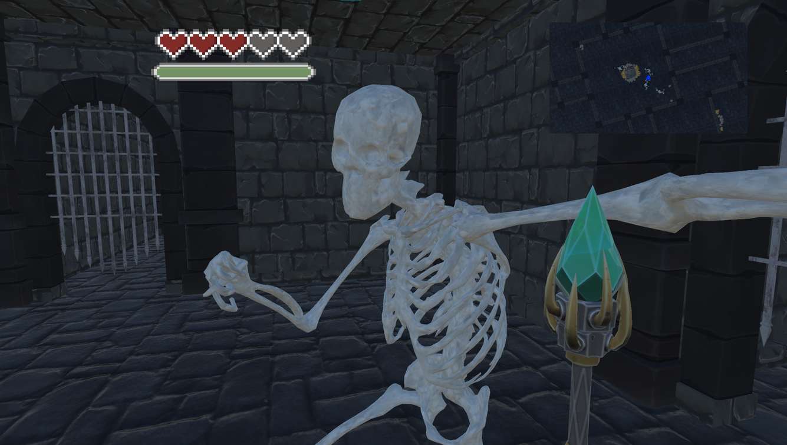
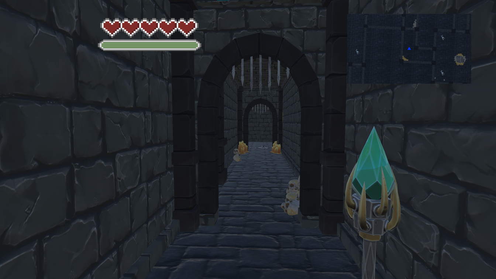
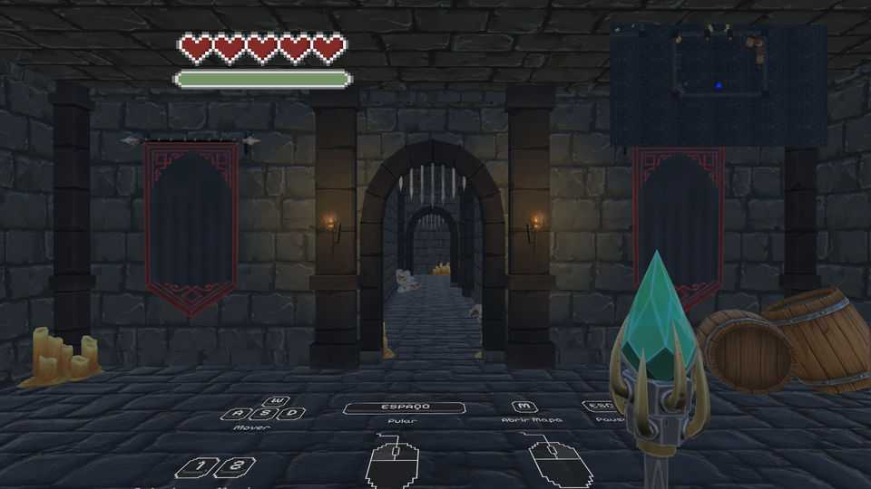
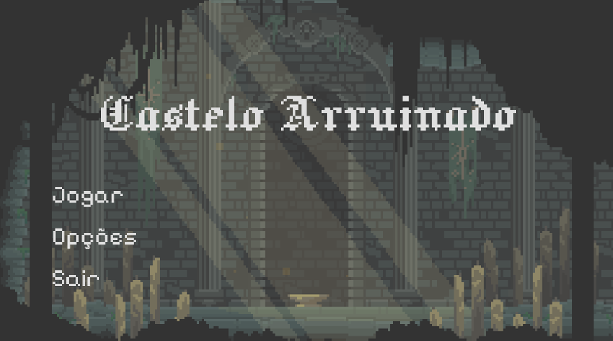
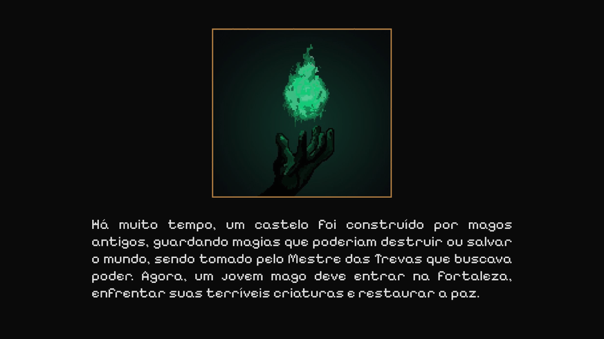
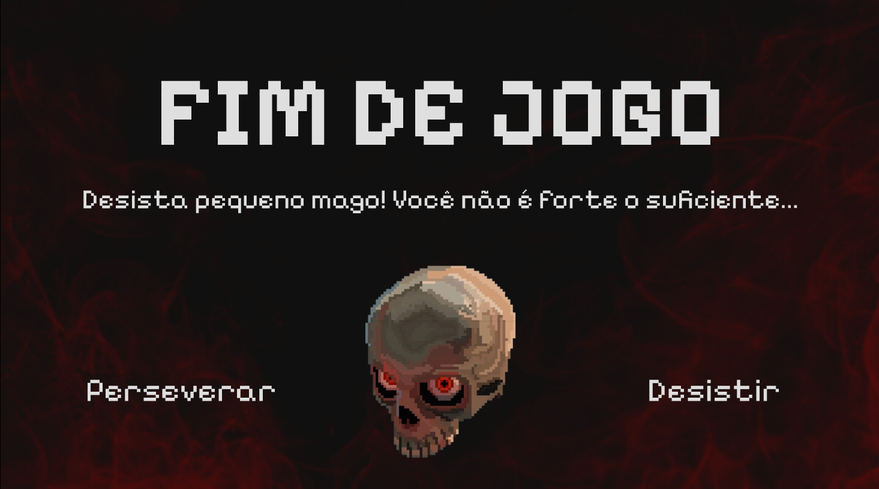

# 🏰 Castelo Arruinado

**Jogo de ação e aventura em primeira pessoa, com permadeath, em um universo medieval sombrio de magia e mistério.**

---

## 📸 Telas

| Combate | Exploração |
| --- | --- |
|  |  |
| **Salão do castelo** | **Menu inicial** |
|  |  |
| **Introdução** | **Fim de jogo** |
|  |  |

## 📖 História

Há muito tempo, magos antigos ergueram um castelo para guardar magias capazes de destruir ou salvar o mundo. A fortaleza foi tomada por forças corrompidas. Agora um jovem mago precisa atravessar o castelo labiríntico, enfrentar suas criaturas e chegar à batalha final contra o Arquimago Supremo.

## 🎯 Objetivo

- Explorar o castelo, encontrar a sala final e derrotar o Arquimago Supremo.
- **Permadeath:** ao morrer, o jogador volta ao início e perde as magias. A proposta é aprender, planejar e melhorar a cada tentativa.

## 🎮 Controles

| Comando | Ação |
| --- | --- |
| W, A, S, D | Mover |
| Espaço | Pular |
| 1 e 2 | Selecionar magia |
| Botão esquerdo do mouse | Magia básica |
| Botão direito do mouse | Magia especial |
| Esc | Pausar |

## ✨ Magias

As magias consomem mana e têm tempo de recarga.

- 🟣 **Disparo Arcano**
- 🔥 **Bola de Fogo**
- ❄️ **Disparo Congelante**

## 💀 Inimigos

- **Esqueleto Guerreiro**
- **Esqueleto Mago**
- **Arquimago Supremo**, o chefe final

## 🖥️ Interface

- Vida em corações e barra de mana
- Minimapa para a exploração do castelo
- Menu inicial, tela de introdução e tela de fim de jogo

## 🧪 Teste com jogadores

O jogo passou por uma rodada de testes com um formulário de dez perguntas sobre impressão geral, facilidade de aprender, interface, controles, bugs encontrados e nota final. A versão 2.0 é a mais recente.

## 👥 Equipe e minha participação

Projeto acadêmico do curso de Sistemas de Informação, feito em uma equipe de sete pessoas em 2025.

**Minha parte:** programação e design do jogo, com toda a implementação na Unity.

## 📫 Contato

